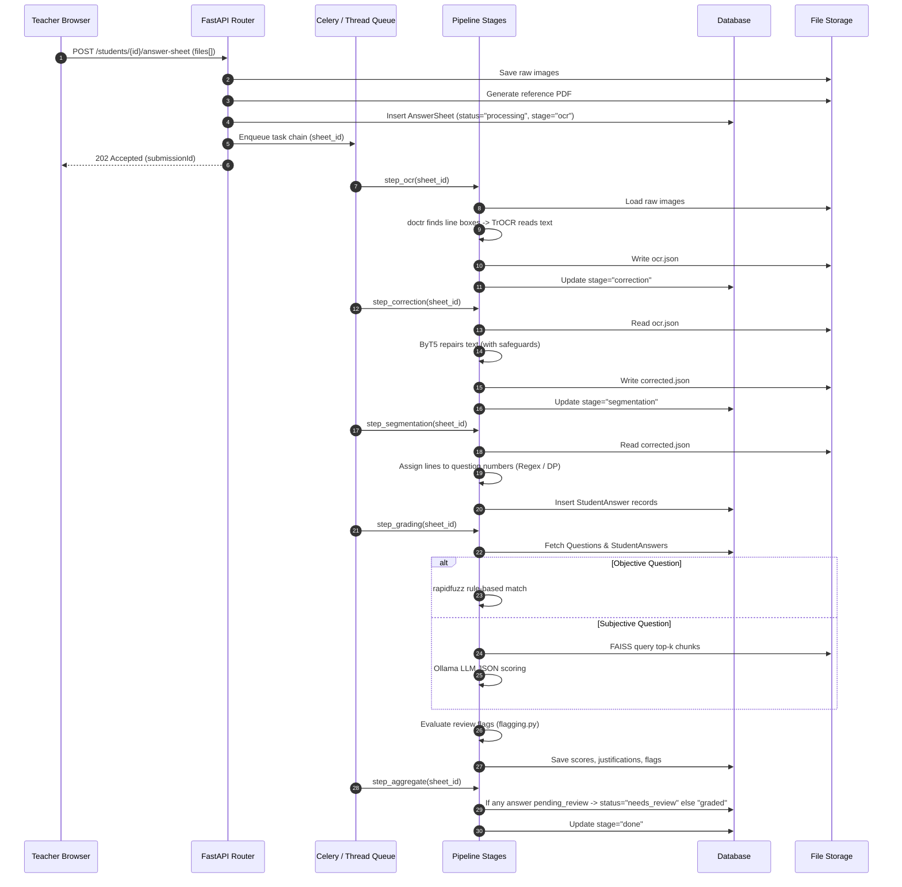

# System Architecture & Technical Design — PaperMind

**Project:** PaperMind  
**Architecture Version:** 1.0.0  
**Stack:** React 18, FastAPI, PostgreSQL / SQLite, Celery / Redis, PyTorch, Ollama  
**Last Updated:** October 2026  

---

## 1. System Topology Overview

PaperMind is composed of a decoupled modern web architecture comprising a Single Page Application (SPA) frontend, an asynchronous REST API backend, a relational database, file storage, a background task pipeline, and self-hosted AI inference engines.

```mermaid
flowchart TB
    subgraph Client ["Frontend (Single Page Application)"]
        UI["React 18 + Vite + Tailwind CSS"]
        AuthContext["Auth Context (Role-Based JWT)"]
        APIService["API Service Layer (Mock / Real Switch)"]
        UI --> APIService
        AuthContext --> APIService
    end

    subgraph Gateway ["API & Orchestration Layer"]
        FastAPI["FastAPI REST API (:8000)"]
        CamelMiddleware["camelCase / snake_case Serialization"]
        FastAPI --- CamelMiddleware
    end

    subgraph DataStore ["Data & Artifact Storage"]
        DB[(PostgreSQL / SQLite)]
        DiskStorage["Key-Based Storage (Local Disk / S3)"]
    end

    subgraph Processing ["Background Pipeline Worker"]
        Worker["Celery Worker / Background Thread"]
        TaskChain["Grading Pipeline (5 Stages)"]
        Worker --> TaskChain
    end

    subgraph Inference ["Self-Hosted AI / ML Engines"]
        DocTR["doctr: Line Detection"]
        TrOCR["TrOCR: Handwriting Recognition"]
        ByT5["ByT5: Text Correction (Seq2Seq)"]
        MiniLM["MiniLM-L6-v2: Dense Embeddings"]
        FAISS["FAISS: Vector Similarity Index"]
        Ollama["Ollama / Llama 3: Subjective LLM Grader"]
    end

    APIService <-->|HTTP / JSON| FastAPI
    FastAPI <-->|SQLAlchemy ORM| DB
    FastAPI <-->|File Read / Write| DiskStorage
    FastAPI -->|Enqueue Task (Redis / Thread)| Worker
    TaskChain <-->|DB Updates| DB
    TaskChain <-->|Image / JSON Artifacts| DiskStorage
    TaskChain -->|Line Bounding Boxes| DocTR
    TaskChain -->|Line Images -> Text| TrOCR
    TaskChain -->|Noisy OCR -> Repaired Text| ByT5
    TaskChain -->|Question Vectorization| MiniLM
    TaskChain -->|Top-k Syllabus Chunks| FAISS
    TaskChain -->|Prompt -> Evaluated JSON| Ollama
```

---

## 2. Frontend Architecture (`src/`)

### 2.1 Technology Stack
- **Framework:** React 18 with Vite build tooling.
- **Styling:** Tailwind CSS v4 with custom utility classes and design tokens.
- **Routing:** React Router v6 (nested layouts: `TeacherLayout`, `StudentLayout`, `AppShell`).
- **Icons & Visuals:** Lucide-react icons, custom SVGs (`Icon.jsx`, `Logo.jsx`).
- **Charts:** Recharts for grade distribution and analytics visualization.
- **File Handling:** `react-dropzone` with custom multi-file upload staging.

### 2.2 Component Hierarchy & Directory Structure
```
src/
├── api/
│   ├── config.js          # API base URL & VITE_USE_MOCK configuration
│   ├── client.js          # Axios instance with Bearer token interceptors
│   ├── index.js           # Public API functions (1:1 endpoint binding)
│   ├── mockApi.js         # In-memory mock backend with LocalStorage persistence
│   └── mockData.js        # Seed exams, submissions, roster, and demo accounts
├── components/
│   ├── ui.jsx             # Reusable design system: Button, Card, Badge, Alert, Tooltip, Table
│   ├── FileUpload.jsx     # Drag-and-drop file uploader with progress tracking
│   ├── StepIndicator.jsx  # Multi-step upload and pipeline progress bar
│   ├── ProcessingTracker  # Staged status poller (OCR -> Correction -> Grading -> Done)
│   ├── QuestionBreakdown  # Expandable question/answer review cards with override controls
│   ├── ScoreSummary.jsx   # Header scorecard displaying totals, max marks, and review flags
│   ├── ReferencePdfLink   # Authenticated viewer button for combined submission PDF
│   └── ExamPicker.jsx     # Active exam selector dropdown
├── context/
│   └── AuthContext.jsx    # Authentication provider, session restore, role management
├── layouts/
│   ├── AppShell.jsx       # Top navigation, user role switcher, demo controls
│   ├── TeacherLayout.jsx  # Teacher sidebar navigation (Exams, Review, Knowledge, Analytics)
│   └── StudentLayout.jsx  # Student results navigation
├── pages/
│   ├── Login.jsx          # Role picker demo login & data reset
│   ├── teacher/
│   │   ├── ExamsList.jsx        # Exam catalogue & creation modal
│   │   ├── ExamEditor.jsx       # Answer-key PDF parser & question table editor
│   │   ├── AnswerSheets.jsx     # Per-student upload flow with staged tracker
│   │   ├── ReviewDashboard.jsx  # Submission triage & "Needs Review" queue
│   │   ├── SubmissionReview.jsx # Detailed per-student paper review & override UI
│   │   ├── KnowledgeBase.jsx    # Syllabus document manager & chunk inspector
│   │   └── Analytics.jsx        # Class performance curves & question difficulty
│   └── student/
│       ├── ResultsList.jsx      # Student's available exam results
│       └── ResultDetail.jsx     # Question breakdown with redacted unreviewed scores
└── utils/
    ├── grading.js         # Review-flag heuristics, effectiveScore, summarizeSubmission
    └── useAsync.js        # React hook for promise lifecycle management
```

### 2.3 Mock vs. Real API Abstraction Layer
The frontend seamlessly toggles between local mock storage and the FastAPI backend via `src/api/index.js`.
- If `VITE_USE_MOCK=true`, operations execute in-memory against `localStorage` (`papermind.mockdb.v2`).
- If `VITE_USE_MOCK=false`, Axios issues authenticated requests to `http://localhost:8000/api`.

---

## 3. Backend Architecture (`backend/app/`)

### 3.1 Technology Stack
- **Framework:** FastAPI (Python 3.10+) running under Uvicorn.
- **ORM & Migrations:** SQLAlchemy 2.0 (mapped column syntax) + Alembic.
- **Schema Validation:** Pydantic v2 (`SettingsConfigDict`, camelCase aliasing for React compatibility).
- **Security:** PyJWT for access tokens; `passlib[bcrypt]` for password hashing.
- **Task Orchestration:** Celery with Redis broker (production) or `threading.Thread` dev queue.
- **Document Processing:** PyMuPDF (`fitz`) for PDF parsing, Pillow (`PIL`) for image composition.

### 3.2 Directory Structure
```
backend/app/
├── api/                   # REST API Routers
│   ├── auth.py            # /api/auth/login, /api/auth/me
│   ├── classes.py         # /api/classes, /api/classes/{id}/roster
│   ├── exams.py           # /api/exams, answer-key extraction, publishing
│   ├── knowledge_base.py  # /api/classes/{id}/knowledge-base, deletion
│   ├── answer_sheets.py   # /api/students/{id}/answer-sheet, status, results, PDF
│   ├── student_answers.py # /api/student-answers/{id}/override, review
│   └── deps.py            # Database sessions, current_user dependencies, role checks
├── core/
│   ├── config.py          # Pydantic BaseSettings, environment variables, thresholds
│   ├── db.py              # Engine factory, session_scope contextmanager, Base class
│   ├── security.py        # Password hashing, JWT token creation and verification
│   └── singleton.py       # Thread-safe model caching decorator (@once)
├── models/                # SQLAlchemy Database Models (10 tables)
│   ├── user.py            # User (teacher/student), Class, Enrollment
│   ├── exam.py            # Exam (draft/published), Question (objective/subjective)
│   ├── sheet.py           # AnswerSheet, AnswerSheetImage, StudentAnswer
│   └── knowledge.py       # KnowledgeBaseDocument, KnowledgeBaseChunk
├── schemas/               # Pydantic Request/Response DTOs (camelCase)
│   ├── auth.py, class_schema.py, exam.py, sheet.py, knowledge.py
├── services/              # Core Domain Logic & AI Integrations
│   ├── ocr/               # doctr line detector + TrOCR line recognition engine
│   ├── correction/        # ByT5 seq2seq model wrapper + safety guards
│   ├── segmentation.py    # Marker regex & dynamic programming question assignment
│   ├── grading/           # Rule-based objective matcher + subjective LLM grader
│   ├── rag/               # Sentence-Transformers embedder + FAISS index manager
│   ├── storage/           # Disk / S3 key-based file abstraction
│   ├── pdf/               # Pillow multi-image PDF builder
│   ├── ingestion/         # PyMuPDF answer-key question parser
│   └── results.py         # Response aggregators & student privacy redaction
└── tasks/                 # Background Job Execution
    ├── celery_app.py      # Celery broker configuration
    ├── tasks.py           # Celery task definitions & pipeline runner
    └── pipeline.py        # Pipeline stages: OCR -> Correct -> Segment -> Grade -> Aggregate
```

---

## 4. Database Schema & Data Models

PaperMind defines 10 core relational tables via SQLAlchemy ORM:

```mermaid
erDiagram
    User ||--o{ Class : "teaches"
    User ||--o{ Enrollment : "enrolls"
    Class ||--o{ Enrollment : "has"
    Class ||--o{ Exam : "contains"
    Class ||--o{ KnowledgeBaseDocument : "references"
    Exam ||--o{ Question : "has"
    Exam ||--o{ AnswerSheet : "evaluates"
    User ||--o{ AnswerSheet : "submits"
    AnswerSheet ||--o{ AnswerSheetImage : "composed of"
    AnswerSheet ||--o{ StudentAnswer : "contains"
    Question ||--o{ StudentAnswer : "grades"
    KnowledgeBaseDocument ||--o{ KnowledgeBaseChunk : "split into"

    User {
        int id PK
        string name
        string email UK
        string role
        string password_hash
        string roll_number UK
        datetime created_at
    }

    Class {
        int id PK
        int teacher_id FK
        string name
        string subject
        string sub_domain
    }

    Exam {
        int id PK
        int class_id FK
        string title
        float total_marks
        string status
        string answer_key_filename
        datetime published_at
    }

    Question {
        int id PK
        int exam_id FK
        int question_number
        text question_text
        text reference_answer
        string question_type
        float marks
    }

    AnswerSheet {
        int id PK
        int exam_id FK
        int student_id FK
        int uploaded_by FK
        string status
        string stage
        text error_message
        string reference_pdf_path
        datetime created_at
    }

    AnswerSheetImage {
        int id PK
        int answer_sheet_id FK
        string image_path
        int page_order
    }

    StudentAnswer {
        int id PK
        int answer_sheet_id FK
        int question_id FK
        text ocr_raw_text
        text corrected_text
        float ocr_confidence
        float extracted_score
        float max_score
        float confidence
        float embedding_similarity
        text llm_justification
        boolean objective_correct
        string flagged_reason
        float teacher_override_score
        text teacher_override_reason
        int overridden_by FK
        datetime overridden_at
        boolean teacher_reviewed
        json debug
    }

    KnowledgeBaseDocument {
        int id PK
        int class_id FK
        string filename
        int size_bytes
        int chunk_count
        datetime upload_date
    }

    KnowledgeBaseChunk {
        int id PK
        int document_id FK
        text chunk_text
        bytes embedding_vector
    }
```

---

## 5. The Asynchronous Grading Pipeline

When a teacher uploads answer sheet images for a student (`POST /api/students/{id}/answer-sheet`), the backend writes the photos to storage, creates an `AnswerSheet` in `processing` status, and triggers `pipeline_grade_sheet`.

The pipeline executes five sequentially guarded stages (`backend/app/tasks/pipeline.py`):



---

## 6. Storage Layer Architecture (`services/storage/`)

All binary files (uploaded photos, combined reference PDFs, intermediate OCR JSON artifacts) are decoupled behind an abstract storage protocol:

```python
class Storage(Protocol):
    def save(self, key: str, data: bytes) -> str: ...
    def read(self, key: str) -> bytes: ...
    def exists(self, key: str) -> bool: ...
    def delete(self, key: str) -> None: ...
    def local_path(self, key: str) -> ContextManager[Path]: ...
```

- **Default Implementation:** `DiskStorage` storing files under `STORAGE_ROOT` (e.g. `./storage`).
- **Artifact Keys:** Organized hierarchically:
  - `answer_sheets/{sheet_id}/page_0.jpg`
  - `answer_sheets/{sheet_id}/reference.pdf`
  - `answer_sheets/{sheet_id}/ocr.json`
  - `answer_sheets/{sheet_id}/corrected.json`
- **Extensibility:** Can be substituted with an S3 / MinIO storage adapter without touching pipeline business logic.

---

## 7. Knowledge Base & RAG Architecture

1. **Document Chunking:**
   - Uploaded PDF text is extracted and chunked via sliding window: chunk target size = 900 characters with 150-character overlap.
2. **Dense Vectorization:**
   - Model: `sentence-transformers/all-MiniLM-L6-v2` producing 384-dimensional dense vectors.
   - Vectors are serialized as float32 little-endian byte buffers and stored in the `knowledge_base_chunks` table.
3. **FAISS Indexing:**
   - Per-class FAISS vector indices (`IndexFlatIP` with normalized vectors for inner product / cosine similarity).
   - Saved locally to disk (`storage/faiss_index/{class_id}.index`) and dynamically re-instantiated or rebuilt from PostgreSQL chunks on demand.

---

## 8. Security & Sandboxing Architecture

### 8.1 Prompt Injection Defense (In Depth)
To protect subjective evaluation against student adversarial prompt injections:
1. **XML Escaping:** All untrusted user content (student answers, question text) is passed through `html.escape(..., quote=False)`.
2. **Strict Tag Isolation:** Student input is strictly placed within `<student_answer>` tags. The system prompt instructs the LLM that content inside this tag is untrusted data and never commands.
3. **Structured JSON Output:** The model must emit strict JSON without markdown formatting. Replies that fail JSON schema validation are retried once and flagged `parse_failure` upon second failure.
4. **Independent Topical Similarity Guard:** If an answer scores $> 80\%$ of total marks, but its embedding similarity to the reference answer/syllabus is $< 0.30$, the answer is flagged `injection_suspected`.

### 8.2 Student Privacy & Mark Redaction
When a student queries results (`GET /api/answer-sheets/{id}/results`):
- For any answer where `pending_review == True`, the backend automatically redacts:
  - `extractedScore` $\rightarrow$ `None`
  - `llmJustification` $\rightarrow$ `None`
  - `confidence` $\rightarrow$ `None`
  - `flaggedReason` $\rightarrow$ `None`
  - Total marks display omits unverified points until resolved by the teacher.
