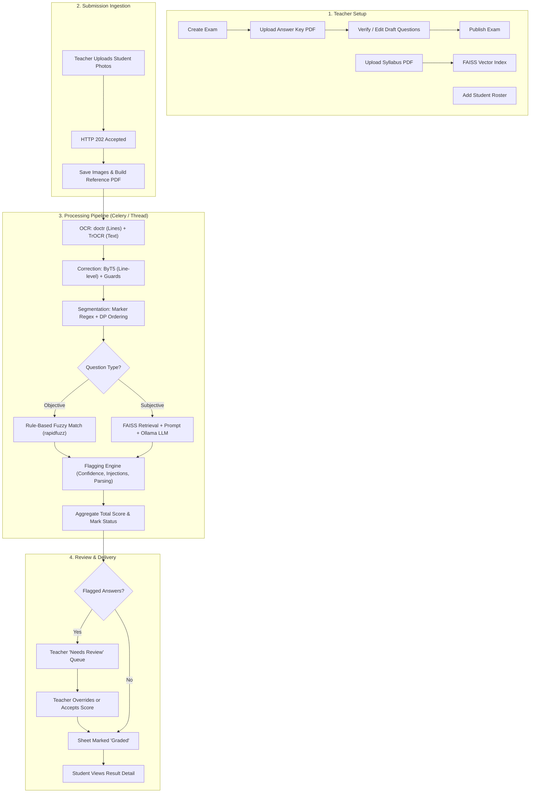

# Minimum Viable Product (MVP) Specification — PaperMind

**Project:** PaperMind  
**Milestone:** MVP v1.0 (Validated End-to-End Pipeline)  
**Target Environment:** Local Dev / On-Premise Single Node (CPU/GPU)  
**Last Updated:** October 2026  

---

## 1. MVP Vision & Core Hypothesis

The MVP of PaperMind is designed to validate one central hypothesis:
> *"Can an entirely open-source, self-hosted AI pipeline (doctr, TrOCR, ByT5, FAISS, Ollama/Llama 3) reliably transcribe and evaluate handwritten student exams with sufficient accuracy that teachers only need to review ambiguous edge cases?"*

The primary milestone is delivering a fully functional, end-to-end evaluation loop with zero dependency on proprietary cloud APIs, while guaranteeing academic fairness through automated review-flagging.

---

## 2. MVP Scope Matrix: Delivered vs. Post-MVP

| Feature Area | In-Scope for MVP (Delivered & Verified) | Out-of-Scope (Post-MVP Roadmap) |
|---|---|---|
| **User Roles** | Teacher (Evaluator) and Student (Viewer). Fixed demo credentials + Roster creation. | Multi-tenant university administration, TA role hierarchies, LDAP/SSO integration. |
| **Exam Setup** | Typed Answer-Key PDF ingestion (PyMuPDF), draft editing, total marks validation, and publishing lock. | Question bank integration, randomized question pools, rubric matrix weighting. |
| **Knowledge Base** | PDF syllabus upload, character chunking (~900 chars), MiniLM embedding, per-class FAISS vector index. | Multi-modal textbook ingestion (diagrams/tables), web-based course catalog syncing. |
| **Submission Ingestion** | Teacher uploads multi-page photo scans per student; auto-assembles reference PDF for viewing. | Student self-upload app, real-time live webcam scanner, automatic edge-detection cropping. |
| **OCR Pipeline** | doctr line detector (`db_mobilenet_v3_large`) + `microsoft/trocr-base-handwritten` line recognition. | Custom TrOCR fine-tuning on regional handwriting; automated deskew, contrast, and bleed-through removal. |
| **Text Correction** | ByT5 seq2seq pipeline wrapper with safety guards (question number prefix guard, digit preservation, Levenshtein distance cap). | ByT5 v2 trained on numbers 1–50+; vocabulary-constrained spell correction. |
| **Question Segmentation** | Heuristic marker regex (`1)`, `Q2.`, `Ans 3:`) + dynamic programming alignment for MCQs + positional fallback. | LayoutLMv3 document layout analysis, visual bounding-box segmentation. |
| **Objective Grading** | Deterministic fuzzy string matching (`rapidfuzz`), option letter extraction, Boolean normalization. | Automated handwritten mathematical equation parsing (LaTeX / Mathpix style). |
| **Subjective Grading** | FAISS top-k retrieval + XML-sandboxed prompt + local Ollama LLM (`llama3.1:8b` / `llama3.2:3b`) + JSON validation. | Key-point rubric breakdown evaluation; teacher calibration fine-tuning. |
| **Review & Security** | Automated review flagging (`low_confidence`, `injection_suspected`, `parse_failure`, `segmentation_uncertain`); teacher overrides with reasons. | Automated second-opinion LLM ensembling; biometric student verification. |
| **Student Experience** | Protected view: "Pending teacher review" masking unreviewed scores and justifications; overall score tallying. | Student appeal/re-evaluation submission portal; automated tutoring recommendations. |
| **Analytics** | Class averages, score tier distribution bar chart, clean vs. flagged breakdown. | Multi-year longitudinal student performance tracking; item-response theory (IRT). |

---

## 3. The End-to-End MVP Workflow



---

## 4. Dual-Mode Architecture (Mock vs. Real Backend)

To enable rapid frontend iteration alongside deep model development, the PaperMind MVP features a complete **dual-mode architecture**:

### 4.1 Mock Mode (`VITE_USE_MOCK=true`)
- Default out-of-the-box state for the frontend.
- Runs completely in-browser with zero backend dependencies.
- Persists mock state in `localStorage` under key `papermind.mockdb.v2`.
- Pre-seeded with realistic data:
  - 3 Exams (OOP Midterm, AI & ML Quiz, Software Engineering Final).
  - 4 Mock Students (Rohan, Ananya, Kabir, Meera).
  - Pre-flagged answers demonstrating `lowConfidence` and `relevanceMismatch` (prompt injection).
- Features a **"Reset demo data"** button on the login screen to clear local modifications.

### 4.2 Real Backend Mode (`VITE_USE_MOCK=false`)
- Connects directly to the FastAPI server (`http://localhost:8000/api`).
- Uses JWT authentication via demo credentials (`kulkarni@college.edu`, `rohan@students.papermind.local`).
- Every endpoint in `src/api/index.js` toggles cleanly:
  ```javascript
  export const getExams = () =>
    USE_MOCK ? mock.getExams() : data(http.get('/exams'));
  ```

---

## 5. Verification & Testing Status

### 5.1 Automated Unit & Integration Tests
- **Status:** 48+ passing unit tests in `backend/tests/`.
- **Test Matrix:**
  - `test_ingestion.py`: Answer-key PDF parsing, question count, mark sums, draft validation.
  - `test_grading_units.py`: Objective matching rules (case, whitespace, bools, fuzzy ratios), XML escaping, prompt injection isolation, JSON retry mechanism, flagging logic.
  - `test_e2e_api.py`: Full API lifecycle (auth, class ensure, roster CRUD, exam publication, photo upload, pipeline execution, score override audit, student redaction).
  - `test_real_models.py`: End-to-end smoke test executing real TrOCR, MiniLM embedder, and Ollama `llama3.2:3b`.
  - `test_correction_real_data.py` & `test_correction_training.py`: ByT5 safeguard assertions, Levenshtein distance bounds, digit preservation.

### 5.2 Real Model Execution Proof
- Executed end-to-end via `backend/scripts/e2e_demo.py` over live HTTP endpoints with real TrOCR, MiniLM, and local Ollama (`llama3.2:3b`).
- Database migrations verified cleanly on SQLite and PostgreSQL (`alembic upgrade head` and `downgrade base`).

---

## 6. Known MVP Gaps & Technical Debt

1. **The "Silent Error" Issue (Localisation Bottleneck):**
   - In real-world exams (tested on Mendeley dataset), 76% of lost marks on short answers occurred because OCR mangled the question number (e.g. `38.` for `33.`, `all` for `31.`), resulting in an empty extracted answer.
   - *Fix Needed:* Add an explicit `answer_not_found` flag to alert the teacher whenever a question yields zero text.
2. **Bleed-Through and Blank Pages:**
   - TrOCR hallucinates fluent nonsense when processing blank back pages with mirrored ink bleed-through from the front.
   - *Fix Needed:* Image preprocessing pipeline (contrast normalization, blank page detection, bleed-through suppression).
3. **ByT5 Training Marker Range:**
   - ByT5 v1 was trained only with question markers 1–10. On real exams with 20+ questions, it tended to truncate `24.` to `2.`.
   - *Mitigation:* Runtime safeguard `split_prefix` detaches leading numbers before correction; v2 training data must include markers 1–50+.
4. **Constrained MCQ Decoding:**
   - For single-letter answers (`A`, `B`, `C`, `D`), TrOCR free-text generation occasionally confuses `B` with `8` or `D` with `0`.
   - *Fix Needed:* Implement constrained vocabulary decoding for objective answer crops.
5. **CPU Latency:**
   - Running full-page OCR with TrOCR on CPU takes 50–120 seconds per page. A GPU (CUDA) is strongly recommended for production evaluation speeds.

---

## 7. MVP Acceptance Checklist

- [x] Teacher can log in and view classes/exams.
- [x] Teacher can upload answer-key PDF and publish exam.
- [x] Teacher can upload textbook PDF and generate searchable FAISS index.
- [x] Teacher can upload student answer sheet photos.
- [x] Pipeline executes asynchronously without server blocking.
- [x] Objective questions are graded accurately via rule-based fuzzy matching.
- [x] Subjective questions are graded via RAG + local Ollama LLM.
- [x] Prompt injection attempts are neutralized and flagged.
- [x] Ambiguous answers route to teacher review dashboard.
- [x] Teacher can override score with mandatory reason.
- [x] Student view properly masks unverified/pending marks.
- [x] Demo environment runs smoothly on both mock data and real backend.
